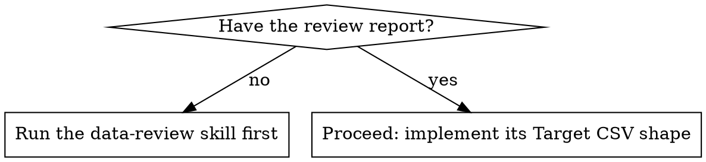

# Data Max — Data Transform

Turn a **review** into **files**. Given a `<filename>-review.md` (the spec) and the
original source file, produce the cleaned warehouse-ready CSV(s) — one file, or N
files when the review decided different grains belong apart. The work product is an
**ad-hoc, rerunnable script** under `tools/` plus the output data, so the next
export can be cleaned the same way without re-deciding anything.

**This skill executes; it does not decide.** The *why* behind every change —
money→mills, ISO dates, unpivot, tenant column, single-vs-multiple — lives in
the **data-review** skill. Here you assume the report already justified each
change and you faithfully implement its "🎯 Target CSV shape".

## Required input — do not skip

You need the review report (`<filename>-review.md`) **and** the original file.



If there is **no** report, stop and run the **data-review** skill first — that is
how the transformation is specified. Don't reverse-engineer a spec by transforming
on instinct: the review is where isolation, grain, and tier decisions were made
*with the user*. The only exception is a tiny, unambiguous one-liner the user
states explicitly ("just rename the headers to snake_case"); even then, prefer a
quick review so the change is documented.

## Workflow

1. **Read the report and the original file.** Anchor on the report's **🎯 Target
   CSV shape** and its **single-vs-multiple** decision — that is your output
   contract. Note every 🔴/🟡 item the user accepted. If the user said they were
   constrained, honor the **🪜 Minimal viable change** instead of the full set.

2. **Plan the passes.** Decide how many scripts and how many output files:
   - Group all row-level fixes that share one read-write pass — strip junk +
     rename + money→mills + ISO dates + tenant column — into **one** cohesive
     script. Don't chain micro-scripts that each re-parse the file.
   - A **reshape that changes the grain** (unpivot wide→long, or splitting file A
     into N grain-specific files) is its own concern — separate script and/or the
     N output files the review named.

3. **Write the script(s)** ad-hoc into the user's `tools/` folder, following the
   reference style:
   - `references/transform-python-example.md` — default; for real parsing or
     reshaping (quoted fields, money/date coercion, unpivot, A→N split). Stdlib
     `csv` only, so it runs anywhere.
   - `references/transform-bash-example.md` — only for simple line-oriented
     surgery (drop preamble/footer, swap a header) where no field is quoted.

4. **Write the sibling `.md`** next to each script (shape below).

5. **Produce the output file(s)** and report counts. Offer to run the script;
   on running, sanity-check the stderr row counts against the source.

## Script conventions

- **Never transform data by hand.** A script is repeatable, auditable, and reruns
  on the next export. If a change genuinely can't be scripted, say so and skip it.
- **Read input, write output — never in place.**
- **Name by what it does:** `clean_sales_export.py`, `unpivot_months.py`,
  `split_orders_and_lines.py`.
- **Group by pass, not by checkbox** (see step 2). Split scripts only when a
  concern is genuinely independent or reshapes the data differently.
- **Dependency-free where possible** (stdlib `csv`).
- **Report to stderr** how many rows were written and how many dropped, so the
  user can sanity-check the count.

**Output data files:** write to the project root (next to where the user runs the
script), named `<original_stem>_clean.csv` — or, when one input becomes several,
`<grain>.csv` (e.g. `orders.csv` / `order_lines.csv`) exactly as the review named
them. State the output path(s) in the sibling `.md`.

## Sibling `.md` shape

For each `tools/<verb>_<subject>.py`, write `tools/<verb>_<subject>.md` with:

- **What it does** — one paragraph.
- **Before → after** — a tiny example of the change.
- **Run command** — copy-pasteable, e.g.
  `python tools/normalize_sales.py input.csv output.csv`.
- **Where the output goes** — the output path and what to do with it (upload to
  warehouse / hand to next step).
- **Re-run prompt** — a concise prompt the user can paste back later, e.g.
  *"Use tools/normalize_sales.py to clean my latest export — ask me which file."*
  This lets them re-invoke the tool in a fresh session without re-explaining.

Example:

```markdown
# unpivot_months.py

## What it does
Rotates a wide monthly sales export (one column per month) into long/tidy rows —
one row per (product, month) — so it loads cleanly and supports GROUP BY month.

## Before → after
Before: product,Jan,Feb,Mar  /  Widget,120,140,160
After:  product,month,units  /  Widget,2026-01,120  (+ one row per month)

## Run command
python tools/unpivot_months.py sales_wide.csv sales_long.csv --year 2026

## Where the output goes
Writes sales_long.csv in the project root. Upload that file to the warehouse
instead of the original.

## Re-run prompt
"Use tools/unpivot_months.py to unpivot my latest monthly sales export — ask me
which file and what year."
```

## Other input formats

For JSON/XML/Excel, the report already decided how the nesting flattens into rows
and how many CSVs result. Implement that: read the structure, emit the flat CSV(s)
the report specified. Everything downstream (money, dates, names, isolation, time
dimension) is identical to the CSV case.
